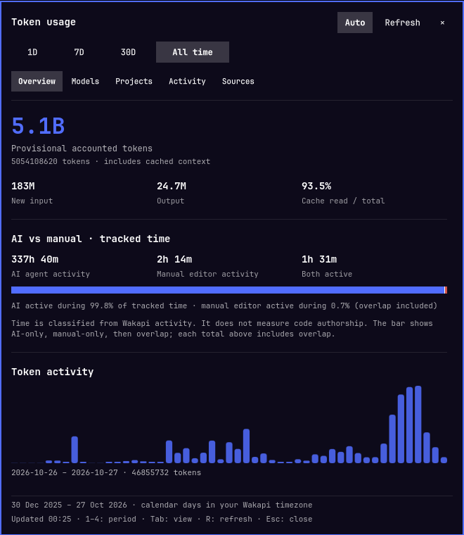

# Token Usage for Omarchy

An [Omarchy](https://omarchy.org) bar widget that shows how many AI tokens your coding agents
used, how your time splits between agents and manual editing, and which models, projects and
machines it came from. It reads the dashboard API of a
[Wakapi fork](https://github.com/Andrew-Girgis/wakapi) with a counted token ledger.
Plugin ID: `girgie.token-usage`.



## Requirements

- Omarchy 4.0 or newer with shell plugins (tested on 4.5).
- A server running [Andrew-Girgis/wakapi](https://github.com/Andrew-Girgis/wakapi). Stock
  Wakapi doesn't have the `/api/dashboard/*` endpoints this widget reads. The easiest way to
  run it is the [Mnemosyne](https://github.com/Andrew-Girgis/mnemosyne) stack, which builds
  the fork for you.
- WakaTime clients (editor or agent plugins) sending heartbeats to that server, and the
  token ledger collector for token counts (see the fork's `docs/dashboard`).
- Python 3.11+ at `/usr/bin/python3` (standard on Omarchy). No packages to install.

## Install

```sh
omarchy plugin add https://github.com/Andrew-Girgis/omarchy-token-usage --enable
```

It uses the same connection as your WakaTime clients: `api_url` and `api_key` from
`~/.wakatime.cfg`. `api_url` must be HTTPS, or HTTP on `localhost`/`127.0.0.1`. To use a
different server, set `WAKAPI_API_URL` and `WAKAPI_API_KEY` in the session environment.

Update with `omarchy plugin update girgie.token-usage`; remove with
`omarchy plugin remove girgie.token-usage`.

### Ask an agent to install it

> Install the Omarchy bar widget from https://github.com/Andrew-Girgis/omarchy-token-usage
> with `omarchy plugin add <url> --enable`. Check that `~/.wakatime.cfg` has an `api_url`
> pointing at a Wakapi server built from github.com/Andrew-Girgis/wakapi, without printing
> the API key. Run `/usr/bin/python3 ~/.config/omarchy/plugins/girgie.token-usage/usage.py
> --range 1d --summary` and tell me whether `status` is `ok`.

## Using it

The bar shows **today's accounted tokens**. Click it for **1D, 7D, 30D, All time**
and five views:

- **Overview:** exact and compact totals, daily token trend, input/output/cache
  counts, AI/manual/overlapping tracked time, sessions, and partial API-equivalent value.
- **Models:** token rankings by model and tool; agent-reported line changes.
- **Projects:** rankings by token consumption or tracked time; Show more expands the list.
- **Activity:** tracked time, average per active day, current streak, weekday/hour
  heatmap, and language/editor/category rankings.
- **Sources:** latest machine activity, accounting coverage, and endpoint failures.

Use **1–4** or Left/Right to select a period, **Tab** for views, **Up/Down** to
scroll, **R** to refresh, and **Esc** to close. Right/middle-clicking the bar
also refreshes. Hover daily bars and heatmap cells to inspect their values.

## Data and interpretation

Periods are calendar days in the **Wakapi account timezone**, including today.
All time begins at the server's earliest heartbeat or counted ledger event.
The last daily bin may be incomplete. Long histories are grouped into at most
60 consecutive bins, preserving every day's token count.

Token total = new input + cache reads + cache writes + unknown input/cache split
+ output. Reasoning is already included in output and is never added again.
The server suppresses overlapping fallback observations and duplicate copied
events. All-time means available recorded history, not certified lifetime usage.
The adapter refuses to silently replace ledger counts with legacy heartbeat tokens.

**AI versus manual is a tracked-time measure, not an authorship measure.** Manual
activity is non-agent editor activity; agents can be working while a person is
editing. The segments show AI-only, manual-only, and overlapping time. No recorded
manual activity does not prove that all code was AI-written. Agent-reported line
changes are not sufficient to calculate a human-versus-AI authored-code percentage.

Heatmap hours follow Wakapi's timezone. Agent and manual heatmap values are
summed, so simultaneous activity can overlap. The current streak looks back
outside the selected period. Machine status is current rather than historical.

Cost comes from the server's verified partial pricing, explicitly in its stated
currency (currently USD). It is equivalent API value at configured rates, not
paid spend. Unpriced tokens remain visible.

## Connection and privacy

`usage.py` uses only the Python standard library and reads the existing
`~/.wakatime.cfg` **at runtime**. It never copies the key into the plugin,
logs, QML, shell.json, or command arguments. Optional `WAKAPI_API_KEY` and
`WAKAPI_API_URL` environment overrides allow `s` injection; no `.env` is used.
The plugin never writes your WakaTime configuration.

Only authenticated, read-only GET requests go to the configured Wakapi
server. No provider API keys, AI inference calls, external analytics, or telemetry
are used. Redirects are refused, each request times out after 15 seconds, and each
response is limited to 4 MiB. Counts, labels, timestamps, and collections are
validated. All plugin text uses PlainText; shared shell tooltip text is neutralized.

With **Auto** enabled, the bar refreshes every five minutes and the open panel
every minute. **Paused** disables both timers; opening/changing a period or pressing
Refresh still requests data. The setting persists in this widget's shell.json entry.

Aggregate snapshots are cached with owner-only permissions under
`~/.cache/omarchy-token-usage/`, separated by server/account/period. Cache TTL is
60 seconds, expires at the range boundary, and Refresh bypasses it. Cached data
is labelled stale on connection failure. Failed sections are unavailable rather
than displayed as zero. No transcripts, prompts, or raw heartbeats are downloaded.

This plugin targets the fork's dashboard API extensions:
`/api/dashboard/{overview,tokens,activity,projects,breakdown,agents,machines}`.
It is not a generic client for an unmodified upstream Wakapi release.

## IPC

Files and configuration hot-reload. Packaged Omarchy files are never modified.

IPC examples:

```bash
omarchy-shell girgie.token-usage open
omarchy-shell girgie.token-usage selectRange 30d
omarchy-shell girgie.token-usage selectTab models
omarchy-shell girgie.token-usage refresh
omarchy-shell girgie.token-usage status
```

## Development

```bash
python3 -m unittest discover -s tests -v
node --test tests/model.test.cjs
omarchy plugin validate .
```

The tests exercise accounting arithmetic, all-time bin conservation, markup
handling, shared tooltip sinks, response limits, ledger-source enforcement,
partial failures, private caching, and stale/account/period isolation.

See [CONTRIBUTING.md](CONTRIBUTING.md). MIT licence, see [LICENSE](LICENSE).
